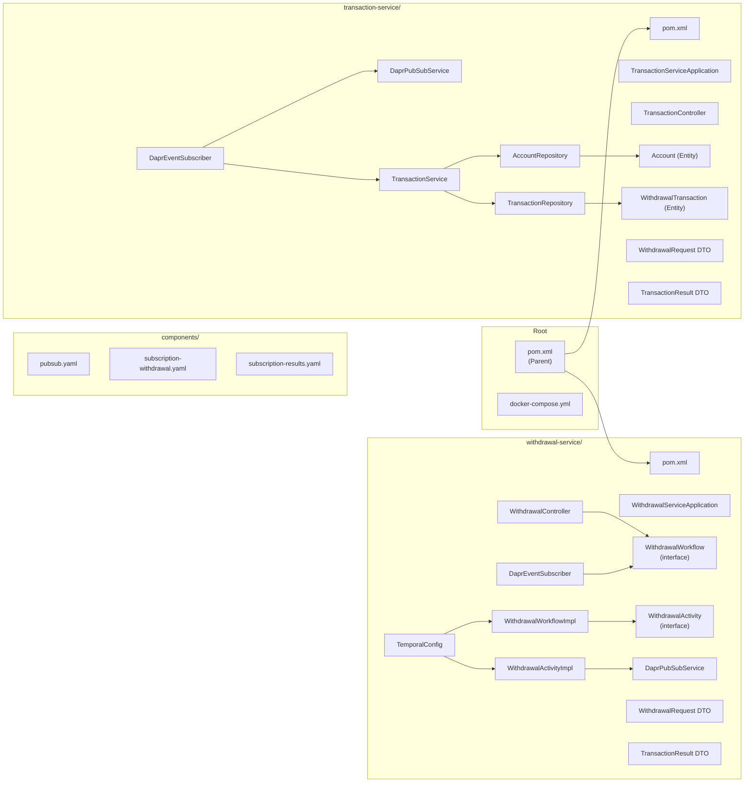

# Banking POC — Complete Component Reference

> Every single file in `c:\Users\Sonux\Desktop\banking-poc`, explained — what it is, what it does, and why it exists.

---

## Project Folder Tree

```
banking-poc/
│
├── 📄 pom.xml                          ← Parent Maven build config
├── 📄 docker-compose.yml               ← All 9 Docker containers (Infra + Microservices)
├── 📄 Banking_POC.postman_collection.json ← Postman API tests
├── 📄 README.md                        ← Project overview
├── 📄 PRESENTATION_GUIDE.md            ← Demo script
│
├── 📁 components/                      ← Dapr configuration files
│   ├── 📄 pubsub.yaml                  ← Dapr Redis Pub/Sub broker config
│   ├── 📄 subscription-withdrawal.yaml ← Dapr subscription for withdrawal-requests
│   └── 📄 subscription-results.yaml   ← Dapr subscription for transaction-results
│
├── 📁 withdrawal-service/              ← Microservice 1 (Port 8081)
│   ├── 📄 pom.xml                      ← Maven dependencies for this service
│   └── 📁 src/main/java/com/bank/withdrawal/
│       ├── 📄 WithdrawalServiceApplication.java  ← Spring Boot entry point
│       ├── 📄 TemporalConfig.java                ← Temporal client + worker setup
│       ├── 📄 WithdrawalController.java           ← REST API endpoint
│       ├── 📄 WithdrawalWorkflow.java             ← Temporal workflow interface
│       ├── 📄 WithdrawalWorkflowImpl.java         ← Temporal workflow implementation
│       ├── 📄 WithdrawalActivity.java             ← Temporal activity interface
│       ├── 📄 WithdrawalActivityImpl.java         ← Temporal activity implementation
│       ├── 📄 DaprPubSubService.java              ← Publishes to Dapr topic
│       ├── 📄 DaprEventSubscriber.java            ← Receives results from Dapr
│       ├── 📄 WithdrawalRequest.java              ← DTO: request data
│       └── 📄 TransactionResult.java             ← DTO: response data
│   └── 📁 src/test/java/com/bank/withdrawal/
│       ├── 📄 ActivityRetryTest.java              ← Test 3: Retry behavior
│       └── 📄 WorkflowSignalTest.java             ← Test 4: Signal handling
│
└── 📁 transaction-service/             ← Microservice 2 (Port 8082)
    ├── 📄 pom.xml                      ← Maven dependencies for this service
    └── 📁 src/main/java/com/bank/transaction/
        ├── 📄 TransactionServiceApplication.java  ← Spring Boot entry point
        ├── 📄 TransactionController.java          ← REST API for accounts
        ├── 📄 DaprEventSubscriber.java            ← Receives requests from Dapr
        ├── 📄 DaprPubSubService.java              ← Publishes results to Dapr
        ├── 📄 TransactionService.java             ← Core banking business logic
        ├── 📄 AccountRepository.java              ← DB access for accounts table
        ├── 📄 TransactionRepository.java          ← DB access for transactions table
        ├── 📄 Account.java                        ← JPA entity: accounts table
        ├── 📄 WithdrawalTransaction.java          ← JPA entity: audit log table
        ├── 📄 WithdrawalRequest.java              ← DTO: incoming request data
        └── 📄 TransactionResult.java             ← DTO: outgoing result data
    └── 📁 src/test/java/com/bank/transaction/
        └── 📄 TransactionServiceTest.java         ← Tests 1 & 2 + idempotency
    └── 📁 src/test/resources/
        └── 📄 application.properties             ← H2 in-memory test database config
```

---

## Part 1: Root Level Files

---

### `pom.xml` — Parent Maven Build Configuration

**File**: [`pom.xml`](../../Desktop/banking-poc/pom.xml)

This is the **parent project descriptor** for the entire monorepo. Maven reads this file first whenever you run `mvn test` or `mvn spring-boot:run`.

**What it configures:**
| Setting | Value | Purpose |
|---|---|---|
| `groupId` | `com.bank` | The Java package namespace for the whole project |
| `artifactId` | `banking-poc-parent` | Name of this root project |
| `packaging` | `pom` | Signals this is a parent POM, not a runnable JAR |
| `modules` | `withdrawal-service`, `transaction-service` | Tells Maven to build both child services when run from the root |
| `java.version` | `17` | Java 17 LTS is required by Spring Boot 3 |
| `spring.boot.version` | `3.3.4` | Centralized — both child POMs inherit this version |
| `temporal.version` | `1.24.1` | Centralized — prevents version conflicts across modules |
| `<parameters>true</parameters>` | Compiler plugin | Required by Spring Boot 3.2+ — preserves method parameter names at compile time so `@PathVariable("id")` can be resolved by name automatically |
| `maven-surefire-plugin` | 3.2.5 | Test runner that enables JUnit 5 test discovery |

**Why it exists**: Without a parent POM, each child service would have to redeclare Spring Boot version, Java version, and compiler settings independently. The parent keeps everything consistent in one place.

---

### `docker-compose.yml` — Infrastructure Orchestration

**File**: [`docker-compose.yml`](../../Desktop/banking-poc/docker-compose.yml)

The single file that **launches the entire infrastructure** with one command: `docker-compose up -d`. Defines and wires together all 7 Docker containers.

**Container Summary:**

| Service Name | Container Name | Image | Ports | Depends On |
|---|---|---|---|---|
| `yugabyte` | `banking-yugabyte` | `yugabytedb/yugabyte:latest` | `5433`, `7000`, `9000` | — |
| `redis` | `banking-redis` | `redis:7-alpine` | `6379` | — |
| `temporal-db` | `temporal-db` | `postgres:15-alpine` | `5432` | — |
| `temporal` | `temporal-server` | `temporalio/auto-setup:1.24.1` | `7233` | `temporal-db` |
| `temporal-ui` | `temporal-ui` | `temporalio/ui:2.26.0` | `8080` | `temporal` |
| `withdrawal-dapr` | `withdrawal-dapr` | `daprio/daprd:1.13.0` | `3500`, `50001` | `redis` |
| `transaction-dapr` | `transaction-dapr` | `daprio/daprd:1.13.0` | `3501`, `50002` | `redis` |

**Key configuration decisions:**
- `hostname: banking-yugabyte` + `PGHOST=banking-yugabyte`: YugabyteDB binds to the container's hostname IP (not `127.0.0.1`), so the hostname must be set explicitly for `ysqlsh` and Spring Boot to connect correctly.
- `DB=postgres12` on `temporal-server`: `temporalio/auto-setup` strictly requires this exact value. Using `postgresql` or `postgres` causes the server to exit on startup.
- `extra_hosts: host.docker.internal:host-gateway`: Allows Dapr containers (running inside Docker) to reach the Spring Boot apps (running on the host machine at ports `8081` and `8082`).
- `--app-channel-address=host.docker.internal`: Tells each Dapr sidecar to forward subscription events to the host machine rather than looking inside Docker.
- **No `dapr-placement`**: Placement service is only needed for Dapr Actors. This project uses only Dapr Pub/Sub, so placement is intentionally excluded to keep the setup simple.

---

### `Banking_POC.postman_collection.json` — API Test Collection

Pre-built Postman collection with all requests ready to run:
- Seed Account (POST `/api/accounts`)
- Successful Withdrawal — Test 1 (POST `/api/withdrawals`)
- Insufficient Balance — Test 2 (POST `/api/withdrawals`)
- Check Account Balance (GET `/api/accounts/{id}`)
- List All Transactions (GET `/api/transactions`)
- Query Workflow Status (GET `/api/withdrawals/{requestId}/status`)

Import this into Postman via **File → Import** to run all demonstrations without typing curl commands.

---

## Part 2: Dapr Configuration (`components/`)

The `components/` folder is mounted into both Dapr sidecar containers at `/components`. Dapr loads every YAML file from this directory at startup to configure its runtime behaviour.

---

### `components/pubsub.yaml` — Pub/Sub Broker Definition

```yaml
apiVersion: dapr.io/v1alpha1
kind: Component
metadata:
  name: pubsub
spec:
  type: pubsub.redis
  version: v1
  metadata:
  - name: redisHost
    value: redis:6379
  - name: redisPassword
    value: ""
```

**What it does**: Tells Dapr to use Redis (at `redis:6379` on the internal Docker network) as the backing store for all Pub/Sub operations.

**What `name: pubsub` means**: This is the Pub/Sub component name. Microservices reference it in their publish URLs: `http://localhost:3500/v1.0/publish/pubsub/<topic>`. If you change `name` here, you must update it in every service's `application.properties` (`dapr.pubsub.name`).

**Broker swap**: To switch from Redis to Kafka or any other broker, only this file changes — `type: pubsub.kafka` with Kafka-specific metadata. No Java code changes needed.

---

### `components/subscription-withdrawal.yaml` — Withdrawal Request Subscription

```yaml
apiVersion: dapr.io/v2alpha1
kind: Subscription
metadata:
  name: withdrawal-requests-subscription
spec:
  pubsubname: pubsub
  topic: withdrawal-requests
  routes:
    default: /events/withdrawal-requests
scopes:
  - transaction-service
```

**What it does**: A declarative Dapr subscription. Instructs the Dapr runtime that the `transaction-service` app (identified by its `--app-id`) wants to receive all messages published to the `withdrawal-requests` topic. When a message arrives, Dapr forwards it via HTTP POST to `/events/withdrawal-requests` on the transaction service.

**`scopes: [transaction-service]`**: Restricts this subscription to only the app with app-id `transaction-service`. Even if `withdrawal-service` is also running and subscribed programmatically, it will not receive messages from this topic via this declarative subscription.

> [!NOTE]
> Both declarative subscriptions (these YAML files) and programmatic subscriptions (the `GET /dapr/subscribe` endpoint in each service) are configured. The Dapr log shows a harmless warning `two identical subscriptions found`. Both methods work correctly — the declarative YAML is a belt-and-suspenders approach.

---

### `components/subscription-results.yaml` — Transaction Result Subscription

```yaml
apiVersion: dapr.io/v2alpha1
kind: Subscription
metadata:
  name: transaction-results-subscription
spec:
  pubsubname: pubsub
  topic: transaction-results
  routes:
    default: /events/transaction-results
scopes:
  - withdrawal-service
```

**What it does**: Mirror of the above. Instructs the Dapr runtime that `withdrawal-service` wants all messages on `transaction-results` delivered to its `/events/transaction-results` endpoint. This is how the processed transaction result gets routed back to the Withdrawal Service to unblock the waiting Temporal workflow.

---

## Part 3: Withdrawal Service (`withdrawal-service/`)

The Withdrawal Service is the **orchestrator** — it receives client requests, runs a durable Temporal workflow, and waits asynchronously for the transaction result.

---

### `withdrawal-service/pom.xml` — Module Dependencies

**Dependencies declared:**

| Dependency | Why it's needed |
|---|---|
| `spring-boot-starter-web` | Embedded Tomcat + Spring MVC for REST controllers (`@RestController`, `@PostMapping`) |
| `temporal-sdk` | Temporal Java SDK — provides `WorkflowClient`, `WorkflowServiceStubs`, `Worker`, `@WorkflowInterface`, `@ActivityInterface` |
| `spring-boot-starter-test` | JUnit 5 + Mockito + AssertJ for unit and integration tests |
| `temporal-testing` | `TestWorkflowEnvironment` — in-process Temporal server for fast unit tests without a running Docker container |

> [!NOTE]
> This service has **no database dependency**. It has no JPA, no JDBC driver, and no H2. The Withdrawal Service never touches the database directly — that is exclusively the Transaction Service's responsibility.

---

### `WithdrawalServiceApplication.java` — Application Boot Entry Point

```java
@SpringBootApplication
public class WithdrawalServiceApplication {
    public static void main(String[] args) {
        SpringApplication.run(WithdrawalServiceApplication.class, args);
    }
}
```

**What it does**: The JVM entry point. `@SpringBootApplication` is a shortcut for `@Configuration` + `@EnableAutoConfiguration` + `@ComponentScan`. When started, Spring:
1. Scans all classes in `com.bank.withdrawal`
2. Auto-configures embedded Tomcat on port `8081`
3. Processes all `@Bean`, `@Service`, `@RestController`, and `@Configuration` classes
4. Triggers `TemporalConfig` to connect to Temporal Server and start the Worker

---

### `TemporalConfig.java` — Temporal Client & Worker Wiring

**What it does**: The most important configuration class in the Withdrawal Service. It:
1. Creates a `WorkflowServiceStubs` — a gRPC connection to `temporal-server:7233`
2. Creates a `WorkflowClient` — the entry point for starting, signaling, and querying workflows
3. Creates a `WorkerFactory` → `Worker` → registers `WithdrawalWorkflowImpl` and `WithdrawalActivityImpl`
4. Calls `factory.start()` — the Worker begins long-polling the `WITHDRAWAL_TASK_QUEUE` on Temporal Server

**Key constant**: `public static final String TASK_QUEUE = "WITHDRAWAL_TASK_QUEUE"`
This string must match in three places: `TemporalConfig`, `WithdrawalController`, and all tests. It is the logical channel name linking Temporal Server to this Worker.

**Why a `@Configuration` class?** Spring needs to manage the `WorkflowClient` as a Spring Bean so that both `WithdrawalController` and `DaprEventSubscriber` can `@Autowired`-inject it and share the same connection.

---

### `WithdrawalController.java` — REST API Entry Point

**Endpoints exposed:**

| Method | Path | Behaviour |
|---|---|---|
| `POST` | `/api/withdrawals` | **Synchronous** — starts Temporal workflow and blocks until result is returned |
| `POST` | `/api/withdrawals/async` | **Asynchronous** — starts workflow in background, returns `workflowId` immediately |
| `GET` | `/api/withdrawals/{requestId}/status` | **Query** — calls `workflow.getStatus()` to check live workflow state |

**How synchronous blocking works**: Calling `workflow.executeWithdrawal(request)` on a Temporal stub is a blocking call. The calling HTTP thread parks here until the Temporal workflow completes and returns the `TransactionResult`. This can take 1–60 seconds depending on network speed.

**Workflow ID construction**: `"withdrawal-" + request.getRequestId()` — This deterministic ID is what prevents duplicate workflow runs. If `req-001` is submitted twice, only one workflow executes.

---

### `WithdrawalWorkflow.java` — Temporal Workflow Interface

```java
@WorkflowInterface
public interface WithdrawalWorkflow {
    @WorkflowMethod
    TransactionResult executeWithdrawal(WithdrawalRequest request);

    @SignalMethod
    void transactionResultSignal(TransactionResult result);

    @QueryMethod
    String getStatus();
}
```

**What it does**: Defines the **contract** for the workflow. Temporal uses this interface to generate dynamic proxy objects (stubs) that clients can call remotely.

**Three Temporal method types used:**
| Annotation | Method | Meaning |
|---|---|---|
| `@WorkflowMethod` | `executeWithdrawal` | Main entry point. Called once to start and run the workflow |
| `@SignalMethod` | `transactionResultSignal` | Delivers an external event into a running workflow asynchronously |
| `@QueryMethod` | `getStatus` | Read-only inspection of the current workflow state (returns the `status` string) |

---

### `WithdrawalWorkflowImpl.java` — Temporal Workflow Implementation

The core orchestration logic. This class runs **inside Temporal's Worker** process, not in a normal HTTP thread.

**Workflow lifecycle:**
```
executeWithdrawal(request)
  │
  ├─ status = "PUBLISHING_REQUEST"
  ├─ activity.publishWithdrawalRequest(request)   ← Dapr publish with retry
  │
  ├─ status = "WAITING_FOR_RESULT"
  ├─ Workflow.await(60s, () -> result != null)    ← Non-blocking wait
  │
  ├─ [Signal received: transactionResultSignal(result)]
  │   └─ status = "SIGNAL_RECEIVED"
  │
  ├─ status = "COMPLETED"
  └─ return transactionResult                     ← Unblocks HTTP client
```

**Activity retry policy:**
```java
RetryOptions.newBuilder()
    .setInitialInterval(Duration.ofSeconds(1))
    .setMaximumAttempts(3)
    .build()
```
If Dapr is unreachable, Temporal retries the Activity up to 3 times with exponential backoff starting at 1 second. This is what Test 3 demonstrates.

**`Workflow.await()` — the key to durability:**
When `Workflow.await()` is called, Temporal checkpoints the entire workflow state to `temporal-db` and suspends the thread. While suspended, it consumes zero CPU. If the server crashes, Temporal reloads the state from `temporal-db` and resumes from exactly this point.

---

### `WithdrawalActivity.java` — Temporal Activity Interface

```java
@ActivityInterface
public interface WithdrawalActivity {
    @ActivityMethod
    void publishWithdrawalRequest(WithdrawalRequest request);
}
```

**What it does**: Declares the interface for all network-side-effect operations. In Temporal, Workflows must be **purely deterministic** (no I/O, no random numbers, no system clocks). Any code that calls the network, reads files, or has side effects **must** be placed in an Activity.

**Why it's separate from the implementation**: Temporal generates a remote proxy from this interface. When the workflow calls `activity.publishWithdrawalRequest(request)`, it doesn't directly call the Java method — it schedules an Activity Task on Temporal Server, which then dispatches it to a Worker.

---

### `WithdrawalActivityImpl.java` — Temporal Activity Implementation

```java
@Component
public class WithdrawalActivityImpl implements WithdrawalActivity {
    @Override
    public void publishWithdrawalRequest(WithdrawalRequest request) {
        daprPubSubService.publishWithdrawalRequest(request);
    }
}
```

**What it does**: The actual code that runs when Temporal dispatches the activity. It simply delegates to `DaprPubSubService` — keeping the Activity thin and testable.

**`@Component`**: This makes it a Spring Bean so it can be `@Autowired` with `DaprPubSubService`, and also so `TemporalConfig` can inject it into the Worker registration.

---

### `DaprPubSubService.java` (Withdrawal Service) — Dapr Publisher

**What it does**: Sends an HTTP POST to the local Dapr sidecar to publish a `WithdrawalRequest` to the `withdrawal-requests` topic.

**Publish URL constructed at runtime:**
```
http://localhost:{dapr.http.port}/v1.0/publish/{dapr.pubsub.name}/withdrawal-requests
→ http://localhost:3500/v1.0/publish/pubsub/withdrawal-requests
```

**Fallback mechanism:**
```java
try {
    // Attempt via Dapr sidecar
    restTemplate.postForEntity(daprPublishUrl, entity, Void.class);
} catch (Exception e) {
    // Dapr not reachable? Send directly to Transaction Service
    restTemplate.postForEntity(directFallbackUrl, entity, Void.class);
}
```

This fallback (`dapr.direct.fallback.url=http://localhost:8082/events/withdrawal-requests`) allows the system to work even without Dapr running — useful for quick local development without Docker.

---

### `DaprEventSubscriber.java` (Withdrawal Service) — Dapr Result Receiver & Temporal Signal Sender

**What it does**: Two responsibilities in one class:
1. **Subscription Discovery** (`GET /dapr/subscribe`): Called by Dapr sidecar at startup. Tells Dapr: "I want messages from topic `transaction-results` delivered to `/events/transaction-results`."
2. **Event Handler** (`POST /events/transaction-results`): Receives the transaction result from Dapr, finds the waiting Temporal workflow by ID, and fires a Signal to unblock it.

**Signal delivery:**
```java
String workflowId = "withdrawal-" + result.getRequestId();
WithdrawalWorkflow workflow = workflowClient.newWorkflowStub(WithdrawalWorkflow.class, workflowId);
workflow.transactionResultSignal(result);
```

The `newWorkflowStub` with a `workflowId` (not `WorkflowOptions`) creates a **stub to an already-running workflow** rather than starting a new one. Calling `transactionResultSignal()` on this stub sends the signal over gRPC to Temporal Server, which delivers it to the paused workflow.

---

### `WithdrawalRequest.java` (Withdrawal Service) — Request DTO

A plain Java object (POJO) carrying three fields: `requestId`, `accountId`, `amount`. Travels the full pipeline:
```
HTTP JSON body → WithdrawalController
              → WithdrawalWorkflowImpl (Temporal state)
              → WithdrawalActivityImpl
              → DaprPubSubService (serialized to JSON)
              → Dapr sidecar → Redis Stream → transaction-dapr → TransactionService
```

Uses `BigDecimal` for `amount` (not `double` or `float`) — essential for financial calculations to avoid floating-point precision errors.

---

### `TransactionResult.java` (Withdrawal Service) — Result DTO

A plain Java object carrying: `requestId`, `accountId`, `amount`, `status`, `message`, `balance`. Travels in the reverse direction:
```
TransactionService → DaprPubSubService → Dapr → Redis → withdrawal-dapr → DaprEventSubscriber
                  → Temporal Signal → WithdrawalWorkflowImpl
                  → WithdrawalController → HTTP 200 response to client
```

---

### `ActivityRetryTest.java` — Test 3: Temporal Activity Retry

**What it tests**: That Temporal automatically retries a failing Activity according to the configured `RetryOptions`.

**Setup**: Uses `TestWorkflowEnvironment` — a full in-process Temporal runtime that runs in memory. No Docker, no ports needed.

**Scenario**:
- Attempt 1: Activity throws `ApplicationFailure("NETWORK_ERROR")` — Temporal catches it, waits 1s, retries
- Attempt 2: Activity throws `ApplicationFailure("TIMEOUT_ERROR")` — Temporal catches it, waits 2s, retries
- Attempt 3: Activity returns `"Action completed on attempt 3"` — test asserts this value

**Why this matters for banking**: Demonstrates that a temporary network blip between the Withdrawal Service and Dapr will NOT cause a lost transaction — Temporal will retry automatically.

---

### `WorkflowSignalTest.java` — Test 4: Temporal Signal Handling

**What it tests**: The full async Signal pattern — that a workflow correctly pauses waiting for a Signal, stays in `"WAITING_FOR_RESULT"` state, and unblocks when the Signal arrives.

**Step-by-step:**
1. Start workflow **asynchronously** (not blocking)
2. `testEnv.sleep(500ms)` — let the workflow run its Activity and enter `Workflow.await()`
3. Assert `workflow.getStatus() == "WAITING_FOR_RESULT"` — proves the workflow is correctly paused
4. Call `workflow.transactionResultSignal(result)` — sends the Signal
5. Assert the final workflow output has `status = "SUCCESS"` and `balance = ₹7,000`

**Uses a stub Activity**: `TestWithdrawalActivityImpl` replaces the real Dapr publish with a no-op, keeping the test purely focused on Signal behavior.

---

## Part 4: Transaction Service (`transaction-service/`)

The Transaction Service is the **business engine** — it processes withdrawal requests, enforces business rules, persists data to YugabyteDB, and returns results.

---

### `transaction-service/pom.xml` — Module Dependencies

| Dependency | Why it's needed |
|---|---|
| `spring-boot-starter-web` | Embedded Tomcat + Spring MVC for Dapr subscriber webhook endpoints |
| `spring-boot-starter-data-jpa` | Spring Data JPA + Hibernate for ORM mapping to YugabyteDB |
| `postgresql` | PostgreSQL JDBC driver — connects to YugabyteDB's YSQL API (which is PostgreSQL wire-compatible) |
| `h2` (runtime) | In-memory database for unit tests. `src/test/resources/application.properties` swaps YugabyteDB for H2 during `mvn test` |
| `spring-boot-starter-test` | JUnit 5 + Spring test context for `@SpringBootTest` integration tests |

> [!NOTE]
> This service has **no Temporal dependency**. Transaction Service is purely reactive — it responds to events from Dapr and writes to the database. All workflow orchestration is done by Withdrawal Service.

---

### `TransactionServiceApplication.java` — Application Boot Entry Point

```java
@SpringBootApplication
public class TransactionServiceApplication {
    public static void main(String[] args) {
        SpringApplication.run(TransactionServiceApplication.class, args);
    }
}
```

Starts the Spring context, connects to YugabyteDB via JDBC, runs Hibernate schema migration (`ddl-auto=update` creates tables if they don't exist), and starts Tomcat on port `8082`.

---

### `TransactionController.java` — Account Management REST API

**Endpoints:**

| Method | Path | Description |
|---|---|---|
| `POST` | `/api/accounts` | Creates or updates an account with an initial balance. Used to seed test data |
| `GET` | `/api/accounts/{id}` | Returns the current balance for an account ID |
| `GET` | `/api/transactions` | Returns all rows from `withdrawal_transactions` — the full audit log |

**Used by**: Postman, curl, or the Postman collection for seeding accounts before running demo scenarios. Not called during the normal withdrawal flow.

---

### `DaprEventSubscriber.java` (Transaction Service) — Event Receiver

**Two responsibilities:**

1. **`GET /dapr/subscribe`** — Discovery endpoint. Tells Dapr sidecar: "Deliver `withdrawal-requests` topic messages to `/events/withdrawal-requests`"

2. **`POST /events/withdrawal-requests`** — The main event handler. Called by `transaction-dapr` when a withdrawal request arrives from Redis:
   - Parses the CloudEvent JSON payload (unwraps from `{ "data": { ... } }` envelope)
   - Calls `transactionService.processWithdrawal(request)` to run business logic
   - Calls `daprPubSubService.publishTransactionResult(result)` to send the result back

**Returns `200 OK`** on success. If it throws and returns `500`, Dapr will retry delivery. **Returns `200 OK`** even for business failures (like insufficient balance) — business failures are handled by the application logic, not HTTP error codes.

---

### `DaprPubSubService.java` (Transaction Service) — Result Publisher

**What it does**: After `TransactionService` completes, this class publishes the `TransactionResult` to the `transaction-results` topic:
```
http://localhost:3501/v1.0/publish/pubsub/transaction-results
```

**Same fallback pattern as Withdrawal Service**: If `transaction-dapr` on port `3501` is unreachable, it falls back to posting directly to `http://localhost:8081/events/transaction-results`.

---

### `TransactionService.java` — Core Banking Business Logic

The most critical class in the entire project. The `processWithdrawal()` method is `@Transactional` — the full block runs inside a single YugabyteDB ACID transaction.

**Four sequential steps:**

#### Step 1: Idempotency Check
```java
Optional<WithdrawalTransaction> existing = transactionRepository.findByRequestId(request.getRequestId());
if (existing.isPresent()) {
    return /* previous result without re-processing */;
}
```
Checks `withdrawal_transactions` for the `request_id`. If found, the same request was already processed — returns the original result with message `"Duplicate request - returned existing result"`. **No funds are moved.** This is the second idempotency layer (after Temporal's workflow ID check).

#### Step 2: Account Lookup
```java
Account account = accountRepository.findById(request.getAccountId()).orElse(null);
if (account == null) {
    // Save FAILED record and return
}
```
Verifies the account exists in the `accounts` table.

#### Step 3: Balance Check
```java
if (account.getBalance().compareTo(request.getAmount()) < 0) {
    // Save FAILED audit record, balance unchanged
}
```
If balance < amount, writes a `FAILED` row to `withdrawal_transactions` and returns without touching the account balance.

#### Step 4: Atomic Debit + Audit
```java
account.setBalance(account.getBalance().subtract(request.getAmount()));
accountRepository.save(account);    // UPDATE accounts SET balance = ?
transactionRepository.save(tx);     // INSERT INTO withdrawal_transactions ...
```
Both SQL statements commit atomically. YugabyteDB guarantees either both succeed or neither does.

---

### `AccountRepository.java` — Accounts Table Access

```java
@Repository
public interface AccountRepository extends JpaRepository<Account, String> { }
```

Extends `JpaRepository<Account, String>` — the second generic type `String` is the type of the primary key (`account_id`). Spring Data JPA automatically provides: `findById()`, `save()`, `findAll()`, `delete()` — no SQL needed.

---

### `TransactionRepository.java` — Transactions Table Access

```java
@Repository
public interface TransactionRepository extends JpaRepository<WithdrawalTransaction, Long> {
    Optional<WithdrawalTransaction> findByRequestId(String requestId);
}
```

Extends `JpaRepository<WithdrawalTransaction, Long>`. Adds one custom method: `findByRequestId()`. Spring Data JPA **auto-generates** the SQL from the method name:
```sql
SELECT * FROM withdrawal_transactions WHERE request_id = ?
```
No `@Query` annotation needed.

---

### `Account.java` — JPA Entity: `accounts` Table

```java
@Entity
@Table(name = "accounts")
public class Account {
    @Id
    @Column(name = "account_id", length = 50)
    private String accountId;

    @Column(name = "balance", precision = 15, scale = 2)
    private BigDecimal balance;
}
```

Maps directly to the `accounts` table in YugabyteDB. Hibernate auto-creates this table when `ddl-auto=update` on first startup.

**`BigDecimal` for balance**: Critical for financial accuracy. `double` or `float` cannot represent ₹10,000.00 exactly in binary — `BigDecimal` stores it as exact decimal digits.

---

### `WithdrawalTransaction.java` — JPA Entity: `withdrawal_transactions` Table

```java
@Entity
@Table(name = "withdrawal_transactions")
public class WithdrawalTransaction {
    @Id @GeneratedValue(strategy = GenerationType.IDENTITY)
    private Long id;

    @Column(name = "request_id", unique = true, nullable = false, length = 64)
    private String requestId;

    @Column(name = "account_id", length = 50)
    private String accountId;

    @Column(name = "amount", precision = 15, scale = 2)
    private BigDecimal amount;

    @Column(name = "status", length = 20)
    private String status;      // "SUCCESS" or "FAILED"

    @Column(name = "message", length = 255)
    private String message;

    @Column(name = "created_at")
    private LocalDateTime createdAt;
}
```

**`unique = true` on `request_id`**: This creates a `UNIQUE` constraint in YugabyteDB at the database level. Even if two requests with the same `requestId` somehow bypass the application-level idempotency check, the database will reject the second `INSERT` with a constraint violation. This is the third and final layer of duplicate protection.

---

### `WithdrawalRequest.java` (Transaction Service) — Incoming Request DTO

Identical structure to `WithdrawalRequest.java` in Withdrawal Service (`requestId`, `accountId`, `amount`). It is **deliberately duplicated** in both services rather than shared via a shared library.

**Why duplicate?** This is a microservices best practice — services should own their own data contracts. A shared library would create tight coupling: a change to `WithdrawalRequest` in a shared module would force both services to be redeployed simultaneously.

---

### `TransactionResult.java` (Transaction Service) — Outgoing Result DTO

Carries the final outcome: `requestId`, `accountId`, `amount`, `status`, `message`, `balance`. Produced by `TransactionService.processWithdrawal()` and published by `DaprPubSubService` to topic `transaction-results`.

---

### `TransactionServiceTest.java` — Tests 1, 2, and Idempotency

**`@SpringBootTest`**: Loads the full Spring application context, using `src/test/resources/application.properties` to swap YugabyteDB for an in-memory H2 database with PostgreSQL compatibility mode.

| Test | Setup | Action | Assertions |
|---|---|---|---|
| `testSuccessfulWithdrawal` | Account `ACC-TEST-001` with ₹10,000 | Withdraw ₹3,000 | Status=`SUCCESS`, result balance=₹7,000, DB balance=₹7,000, audit row saved |
| `testInsufficientBalance` | Account `ACC-TEST-002` with ₹1,000 | Withdraw ₹5,000 | Status=`FAILED`, message=`"Insufficient balance"`, DB balance still ₹1,000, `FAILED` audit row saved |
| `testDuplicateWithdrawalPrevention` | Account `ACC-TEST-003` with ₹10,000 | Withdraw ₹2,000 (success → ₹8,000), then same `requestId` again | Second call returns `"Duplicate..."`, DB balance still ₹8,000 (not ₹6,000) |

**`@BeforeEach cleanUp()`**: Clears all rows from both tables before every test to ensure test isolation.

---

### `src/test/resources/application.properties` — Test Database Configuration

```properties
spring.datasource.url=jdbc:h2:mem:testdb;MODE=PostgreSQL;DATABASE_TO_LOWER=TRUE
spring.datasource.driver-class-name=org.h2.Driver
spring.jpa.database-platform=org.hibernate.dialect.H2Dialect
spring.jpa.hibernate.ddl-auto=create-drop
```

**What it does**: Overrides the main `application.properties` during `mvn test`. Instead of connecting to a running YugabyteDB container on port `5433`, tests use an **in-memory H2 database** with PostgreSQL compatibility mode.

**`MODE=PostgreSQL`**: Makes H2 understand PostgreSQL-specific SQL syntax, so the same Hibernate entities and queries work without modification.

**`ddl-auto=create-drop`**: Creates all tables fresh at the start of each test run and drops them at the end. No leftover data between test runs.

---

## Part 5: Application Configuration Files

---

### `withdrawal-service/src/main/resources/application.properties`

```properties
server.port=8081
temporal.target=127.0.0.1:7233
dapr.http.port=3500
dapr.pubsub.name=pubsub
dapr.direct.fallback.url=http://localhost:8082/events/withdrawal-requests
logging.level.com.bank=INFO
```

| Property | Value | Purpose |
|---|---|---|
| `server.port` | `8081` | Tomcat listens on this port |
| `temporal.target` | `127.0.0.1:7233` | gRPC address of Temporal Server on the host |
| `dapr.http.port` | `3500` | Port of the `withdrawal-dapr` sidecar |
| `dapr.pubsub.name` | `pubsub` | Must match `name:` in `pubsub.yaml` |
| `dapr.direct.fallback.url` | `http://localhost:8082/events/...` | Fallback when Dapr sidecar is not running |

---

### `transaction-service/src/main/resources/application.properties`

```properties
server.port=8082
spring.datasource.url=jdbc:postgresql://localhost:5433/yugabyte
spring.datasource.username=yugabyte
spring.datasource.password=yugabyte
spring.datasource.driver-class-name=org.postgresql.Driver
spring.jpa.database-platform=org.hibernate.dialect.PostgreSQLDialect
spring.jpa.hibernate.ddl-auto=update
spring.jpa.show-sql=true
dapr.http.port=3501
dapr.pubsub.name=pubsub
dapr.direct.fallback.url=http://localhost:8081/events/transaction-results
logging.level.com.bank=INFO
```

| Property | Value | Purpose |
|---|---|---|
| `spring.datasource.url` | `jdbc:postgresql://localhost:5433/yugabyte` | JDBC URL — uses PostgreSQL driver pointing at YugabyteDB YSQL port |
| `driver-class-name` | `org.postgresql.Driver` | Standard PostgreSQL JDBC driver works because YugabyteDB is wire-compatible |
| `ddl-auto=update` | | Hibernate creates/alters tables to match entity definitions on startup |
| `show-sql=true` | | Prints every Hibernate-generated SQL to the console (visible in startup logs) |
| `dapr.http.port` | `3501` | Port of the `transaction-dapr` sidecar |

---

## Component Dependency Map



---

*Document covers all 39 source files, 3 Dapr config files, 2 pom.xml files, and docker-compose.yml in the project. Generated from live code — verified against running system.*
